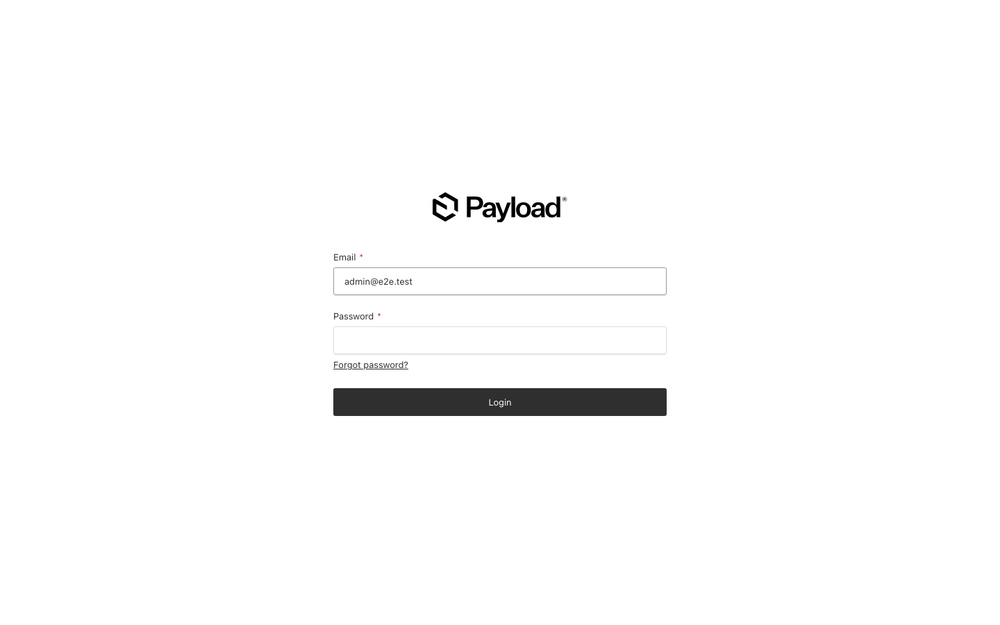
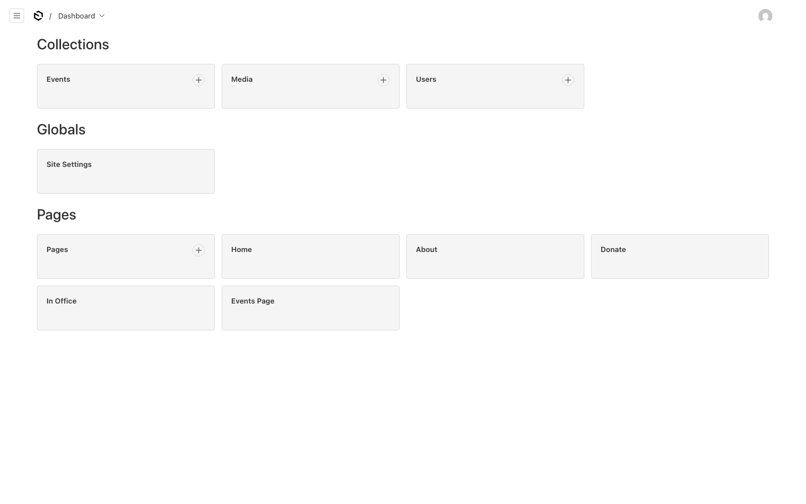
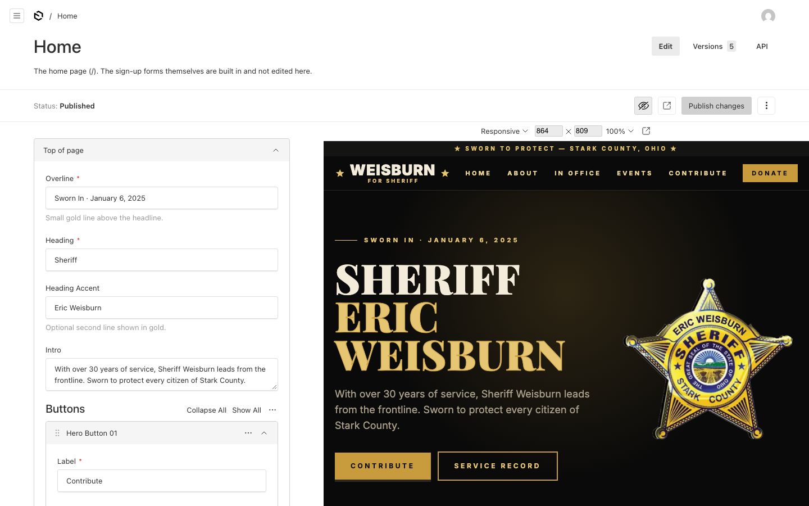
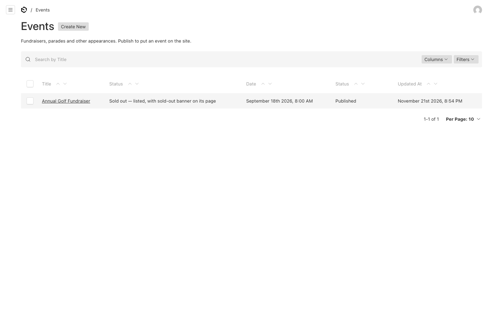
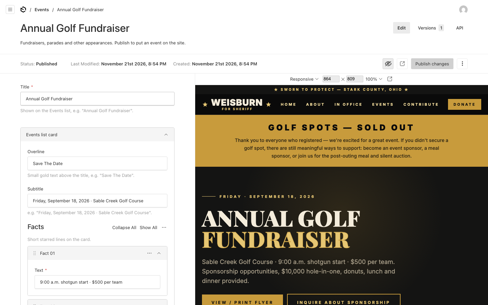
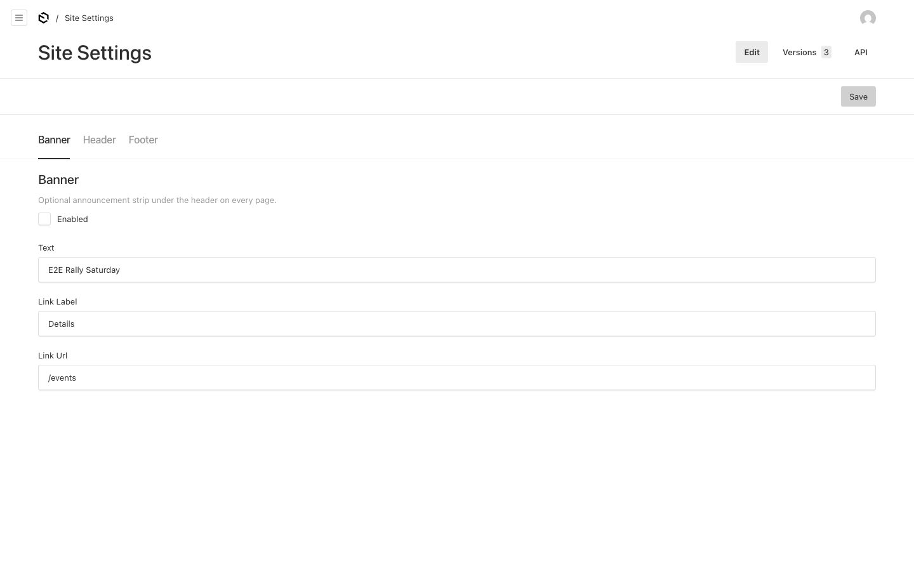
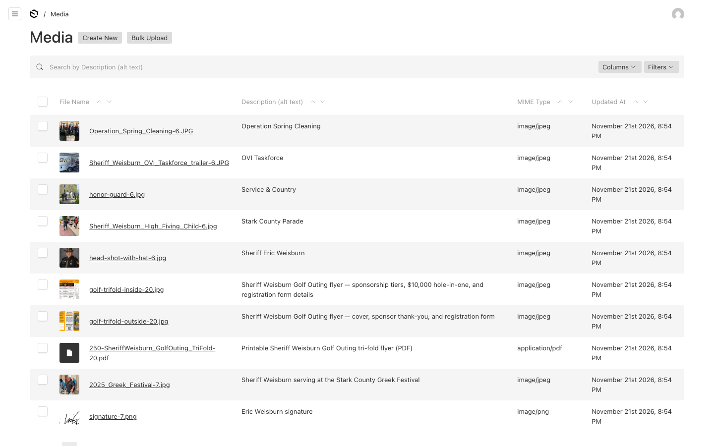
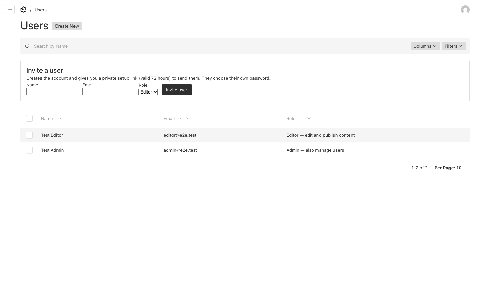
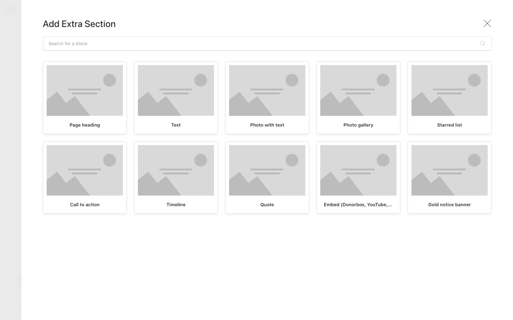
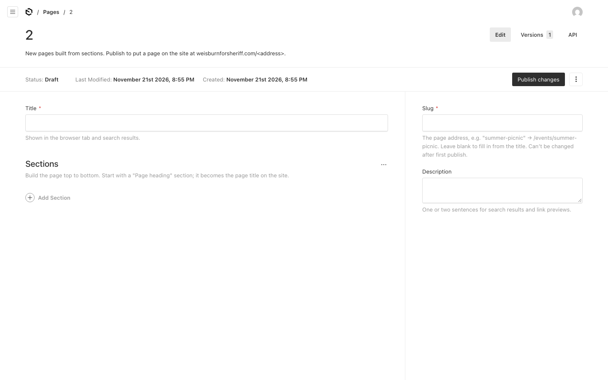

# Editing the Weisburn for Sheriff website

A plain-language guide for people who update the site. You don't need any technical knowledge.

---

## 1. Logging in
- Go to **weisburnforsheriff.com/admin**.
- Your first time, an admin will send you a **setup link**. Open it, choose a password (type it twice) and you're in.
  - The link works **once** and expires after **72 hours**. If it has expired, ask an admin for a new one.
- After that, log in at **/admin** with your email and password.

  

- After logging in you'll see everything you can edit. **Pages** holds the site's pages; **Events**, **Media** and **Site Settings** are above.

  
- **Forgot your password?** Ask an admin. They can send you a new reset link in a few seconds.
- After **5 wrong passwords** your account locks for 10 minutes. Wait, or ask an admin to unlock it.

## 2. How publishing works
- Most pages have a **draft** and a **published** version.
  - **Save draft:** keeps your changes private. Visitors still see the old version.
  - **Preview:** opens the page with your draft changes. A red bar at the bottom reminds you it's a preview. Click **Exit preview** when done.
  - **Publish changes:** your changes go live within about 10 seconds. No need to ask anyone.
  - **Unpublish:** takes the page off the site, but keeps it in the CMS so you can publish it again later.
- **Live preview:** on every page and event, the real page is shown **beside the form** and updates as you type. Your changes are saved as a draft automatically, and visitors don't see them until you publish. Use the **Phone / Desktop** switch above it to check both sizes, or the toggle to hide it.
  

- Every save is kept in **Versions** (top of each page). You can look back at older versions and restore one if needed.

## 3. Events
Go to **Events** in the left menu.

### Add a new event
1. Click **Create New**.
2. Fill in:
   - **Title:** e.g. "Annual Golf Fundraiser". This shows on the Events list.
   - **Status** (right side):
     - **Upcoming:** shown on the Events page.
     - **Sold out:** still shown, and its page gets a gold "sold out" banner.
     - **Past:** the page stays up for people with the link, but it's removed from the Events list.
     - **Hidden:** the page is taken off the site.
   - **Date:** used to put events in order on the Events list.
   - **Remove from listings after** (optional): the event stays on the Events list and the Home page strip through this day, then drops off on its own (Stark County time, within about an hour after midnight). Its own page stays up for anyone with the link. To take the page down too, set Status to **Hidden**.
   - **URL slug:** leave it blank and it's filled in from the title, e.g. `summer-picnic` → weisburnforsheriff.com/events/summer-picnic.
     - Once an event has been published, its address **can't be changed** (so links people shared keep working). Ask an admin if it really must change.
3. **Events list card:** the small gold line above the title, the subtitle (date and place), the starred fact lines, and the link text.
4. **Event page:**
   - **Sold-out banner:** the heading and message shown while the status is "Sold out".
   - **Date line** and **headline**: the headline has two lines; the second is shown in gold.
   - **Paragraph** under the headline.
   - **Buttons:** for each button choose **Web address / site path** (e.g. `/donate`, `https://…`, or `mailto:someone@example.com`) or **Link to file** (pick an uploaded PDF).
   - **Flyer PDF**, and **flyer images** (pictures of the flyer that link to the PDF).
5. Check the live preview beside the form, then click **Publish changes**.

### Mark an event sold out, past, or remove it
Open the event, change **Status**, and click **Publish changes**.

## 4. Announcement banner, menu, header and footer
Go to **Site Settings** (left menu, under Globals).

 These changes go live as soon as you click **Save**; there's no draft step here, so double-check spelling first.
- **Banner tab:** turn the announcement strip on or off, set its text and an optional link (e.g. "Rally Saturday — Details" → `/events`).
- **Header tab:**
  - the thin tagline at the very top;
  - the **navigation menu** (add, remove or reorder links; new pages are not added to the menu automatically);
  - the header and mobile-menu buttons.
- **Footer tab:** the blurb, headquarters address, email, the footer button, Facebook/Instagram links, and the required "Paid for by…" line.

## 5. The pages: Home, About, Donate, In Office, Events Page
They're under **Pages** in the left menu. Each one is a single form, laid out top to bottom in the same order as the page, with each section in its own fold-out group.
- **Small gold lines** (e.g. "★ Career In Service ★"): type only the words. The stars are added for you.
- **Two-line headlines:** the first line is white and the optional second line is gold.
- **Highlighting words:** in fields that say so, wrap words in double stars, like `Are **YOU** with me?`. The page shows them highlighted in that section's style.
- **Lists** (timeline years, starred lines, gallery photos, buttons): use **Add** to add a row, drag the handle to reorder, and the **⋯** menu to remove or duplicate a row.
- **Home → Featured event:** pick which event appears in the strip under the portrait. It shows that event's card details (gold line, title, subtitle) and links to its page. Clear it to hide the strip.
- **Donate → Donorbox form address:** only a `https://donorbox.org/…` address is accepted.
- **Events Page** holds the words around the list of events: the top heading and intro, the list heading, and the "More events coming soon" message shown when nothing is listed.
- The sheriff star badge, the logo and the sign-up forms are part of the design and aren't edited here.

## 6. Pictures and files
- Upload in **Media**, or directly from any image/file field.

  

- **Description (alt text) is required.** Describe the picture for people using screen readers, e.g. "Sheriff Weisburn greeting families at the 2025 parade".
- Accepted: JPEG, PNG, WebP, HEIC photos and PDFs, up to **25 MB** each. Large phone photos are resized automatically.
- A file that's still used on the site **can't be deleted**. The message tells you where it's used; remove it there first.
- To link to a PDF from a button, choose **Link to file**. Don't paste a file's web address.

## 7. Users (admins only)
- **Invite someone:** go to **Users**, use **Invite a user** at the top: enter their name and email and pick a role.
  - **Editor:** can edit and publish all content.
  - **Admin:** can also manage users.

  

  You'll get a setup link to send them privately (text or email). It works once and expires in 72 hours.
- **Reset someone's password / resend an invite:** open the user, then **Copy setup / reset link** on the right. This cancels any earlier link.
- **Remove someone:** open the user and delete them.

## 8. Extra sections and new pages
Both use the same ready-made **sections**. You pick a section type and fill in the words and pictures, and the design (fonts, colours, layout) is applied for you.

| Section | What it's for |
|---|---|
| **Page heading** | The big two-line headline at the top, with an optional photo and buttons. Use it first on a new page. |
| **Text** | Paragraphs with bold, italics, links, lists and sub-headings. |
| **Photo with text** | A photo beside a heading, a paragraph and buttons. The photo can go left or right. |
| **Photo gallery** | Photos two per row, each with a small caption. |
| **Starred list** | Short lines, each with a gold star. |
| **Call to action** | A centred heading, a sentence and buttons, like the end of the In Office page. |
| **Timeline** | Years (or other labels) with a paragraph each, like the About page. |
| **Quote** | A large italic quote on a cream band. |
| **Embed** | A Donorbox form, YouTube video or Facebook post. Paste the embed address. |
| **Gold notice banner** | A full-width gold strip with a short message. |

Most sections have a **Background** choice (Black or Charcoal). Alternate them so sections stand apart.

### Add sections to an existing page
Open the page (e.g. **Pages → In Office**), scroll to **Extra sections** at the bottom, click **Add Extra section**, choose a type and fill it in.

 Extra sections appear after the page's own content, just above the footer. Drag them to reorder. Events have **Extra sections** too.

### Create a new page
1. **Pages → Pages → Create New**.
2. **Title:** shown in the browser tab and search results.
3. **URL slug** (right side): leave it blank to fill it in from the title, e.g. `meet-the-team` → weisburnforsheriff.com/meet-the-team.
   - Some addresses are taken by the site (about, donate, events, time-in-office, admin…) and can't be used.
   - Once published, the address **can't be changed**.
4. **Description** (right side): one or two sentences for Google and link previews.
5. **Sections:** start with a **Page heading**, then add the others you need.
6. Check the live preview beside the form, then **Publish changes**.
7. New pages are **not** added to the menu automatically. To add one, go to **Site Settings → Header → navigation** and add a link to `/meet-the-team`.

To take a page down, use **Unpublish**, which keeps it for later, or delete it.

## Need help?
Contact James. Nothing you do in the editor can break the site's design. Drafts and version history mean any mistake can be undone.
